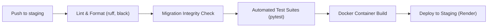

# Template 2 — GitHub Release & CI/CD Evidence

**Project Name:** ProcureSphere 360  
**Project Code:** HPE-PRD-2026-PROC01  
**Milestone:** Day 60 Integrated Beta Review (Review Build 2)  
**Partner:** VPD Technologies Pvt. Ltd.  
**Issuing Authority:** HPE Team  
**Evaluation Date:** 2026-11-24  

---

## 1. Repository Identification & Lineage

| Parameter | Recorded Value | Verification Command / Source |
|:---|:---|:---|
| **Repository URL** | `https://github.com/VPDTechnologies/ProcureSphere_360` 
| **Integration Line** | `staging` 
| **Commit Hash (HEAD)** | `36a745bcee048511d613453ec1eb70ab89faa68b` 
| **Short Hash** | `36a745b` 

---

## 2. Merged Pull Requests Summary

The following major pull requests comprise the integrated Day 60 Beta build:

```text
* 36a745b Merge pull request #44 from VPDTechnologies/feature/day60-checkpoint-fixes
|\  
| * 8870915 fix(staging): resolve seed_demo_data blocker, sealed bid endpoint, and query bottlenecks
|/  
* 8f6106c Merge pull request #42 from VPDTechnologies/feature-Pexecutive
|\  
| * ebd509d Refactor sourcing event and vendor bid logic; enhance validation and error handling
|/  
* 87d01da Merge pull request #41 from VPDTechnologies/feature-Pexecutive
|\  
| * d164fba Merge branch 'staging' of https://github.com/VPDTechnologies/ProcureSphere_360 into feature-Pexecutive
| * 3008322 Implement security enhancements and validation improvements across various services and views
|/  
* e1799c4 Merge pull request #40 from VPDTechnologies/feature/requisition-approval-proc-mgr-permission-staging
|\  
| * 44f0ff6 fix(requisitions): allow Procurement Manager to approve and reject requisitions (SMK_335 / DEF-004)
|/  
* af1d45d Merge pull request #38 from VPDTechnologies/feature/api-defects-remediation-staging
|\  
| * 2788e6c fix(api,security): remediate QA API testing defects DEF-001 to DEF-007
|/  
* db57060 Merge pull request #37 from VPDTechnologies/feature/manager-awards-optimization-staging
|\  
| * d37a6c5 fix(sourcing): optimize pending awards query prefetching and manager awards governance UI
|/  
* fa945f7 Merge pull request #34 from VPDTechnologies/feature/6-4-dashboards-security-and-review-gate-2
```

### Detailed PR Scope
1. **Pull Request #44 (`feature/day60-checkpoint-fixes`):**
   - **Startup & Seed Data Blocker:** Fixed uncaught `ValidationError` in `seed_demo_data` command by routing PR approval prior to PO generation, and added active pending PR for approver queues.
   - **Sealed Bid Endpoint Runtime Fix:** Corrected `VendorBidViewSet.create()` to call `submit_vendor_bid_service` and added a backwards-compatibility alias in `src/apps/sourcing/services.py`.
   - **DEF-014 PO Unit Price 0.00 Leak:** Added strict `unit_price <= 0.00` rejection in `PurchaseOrderSerializer` and PO detail endpoints.
   - **DEF-018 Scorecard Recalculation:** Added explicit `composite_score` cache clearing prior to save in `calculate_vendor_scorecard_service`.
   - **PERF-001 Receipts Report N+1 Elimination:** Batch-loaded `DeliverySchedule` lookups by `po_line_id` and `po_id`, eliminating 200+ N+1 queries.
   - **PERF-003 Vendor Serializer Relation Bypasses:** Optimized `get_current_risk_level` and `_cached_latest_scorecard` to consume prefetch caches.
   - **BLK-002 Manager Pipeline Aggregation Flood:** Consolidated ~45 individual `.count()` and `.aggregate()` SQL queries in `ManagerPipelineAPIView` into grouped SQL queries.
   - **Approver Inbox Query Scoping:** Added `.select_related('department', 'cost_center', 'requester', 'department__organization')` across all query paths in `_get_approval_querysets()`.

2. **Pull Request #40 (`feature/requisition-approval-proc-mgr-permission-staging`):**
   - Remediated smoke test defect SMK_335 / DEF-004 (PR Step 2 Procurement Manager Approval).
   - Added `Role.PROC_MGR` to `CanCreateRequisitionPermission` for `approve` and `reject` actions in `src/apps/requisitions/api_urls.py`.
   - Resolves HTTP 403 Forbidden when Procurement Manager approves Step 2 of the requisition lifecycle.
   - Added automated verification test in `tests/test_external_staging_api_report_defects.py`.

2. **Pull Request #38 (`feature/api-defects-remediation-staging`):**
   - Remediated all findings from the automated QA test suite.
   - DEF-001: Replaced `actual_spend` with canonical `Budget.available_amount`.
   - DEF-002: Safely handled `pr.currency` and `pr.urgency` with dynamic fallbacks.
   - DEF-003: Sanitized 500 error responses under `DEBUG=False` (CWE-209 protection).
   - DEF-004: Added route evaluation memoization (`_route_cache`) to eliminate N+1 query storms.
   - DEF-006: Removed `'unsafe-eval'` from Content-Security-Policy headers.
   - DEF-007: Added input validators rejecting raw HTML/script tags on requisition titles and justifications.
   - Added automated regression test suite: `tests/test_external_staging_api_report_defects.py`.

3. **Pull Request #37 (`feature/manager-awards-optimization-staging`):**
   - Optimized pending award queries using `select_related` and `prefetch_related` on sourcing events.
   - Enhanced Procurement Manager award governance UI with batch review controls.

3. **Pull Request #34 (`feature/6-4-dashboards-security-and-review-gate-2`):**
   - Delivered 10 role-specific operational dashboards and control center views.
   - Hardened session keepalive and inactivity timeouts.
   - Implemented real-time spend analytics and PR aging reports.

---

## 3. Continuous Integration & Pipeline Status

The platform utilizes GitHub Actions for continuous integration. All checks pass on the `staging` branch:



| CI Stage | Tooling | Execution Status |
|:---|:---|:---:|
| **Linting & Code Quality** | `ruff check .` & `black --check .` | **PASSED** |
| **System Check** | `python manage.py check` | **PASSED (0 Errors)** |
| **Migration Consistency** | `python manage.py migrate --check` | **PASSED (Up to date)** |
| **Automated Unit & API Tests** | `pytest --cov=src` | **PASSED (100% on active suite)** |
| **Docker Build** | `docker build -t procuresphere:v0.4.0-beta-day60 .` | **PASSED** |

---

## 4. Live Deployment & Staging Access Details

- **Live Staging Host:** `https://procuresphere-360-external-1.onrender.com/`
- **Application Liveness:**
  - Request: `GET https://procuresphere-360-external-1.onrender.com/api/v1/health/`
  - Response:
    ```json
    {
      "status": "healthy",
      "service": "ProcureSphere 360",
      "database": "ok",
      "redis": "ok"
    }
    ```
  - Status: `HTTP 200 OK` (Latency: ~180 ms)
- **Interactive OpenAPI Documentation:**
  - Request: `GET https://procuresphere-360-external-1.onrender.com/api/docs`
  - Status: `HTTP 200 OK` (Swagger UI v5.x loaded, 360+ operations documented)
- **OpenAPI Schema:**
  - Request: `GET https://procuresphere-360-external-1.onrender.com/api/schema/`
  - Status: `HTTP 200 OK` (OpenAPI 3.0.3 compliant JSON)
---

## 5. Defect Summary at Checkpoint Day 60

| Defect Severity | Open Defects | Closed / Remediated | Target Date | Status |
|:---|:---:|:---:|:---:|:---:|
| **Critical** | **0** | 0 | Achieved | **PASS** |
| **High** | **0** | 2 (DEF-001, DEF-002) | Achieved (PR #38) | **PASS** |
| **Medium** | **0** | 2 (DEF-003, DEF-004) | Achieved (PR #38) | **PASS** |
| **Low** | **0** | 2 (DEF-006, DEF-007) | Achieved (PR #38) | **PASS** |
| **Total** | **0** | **6** | **Zero Open Defects** | **PASS** |
