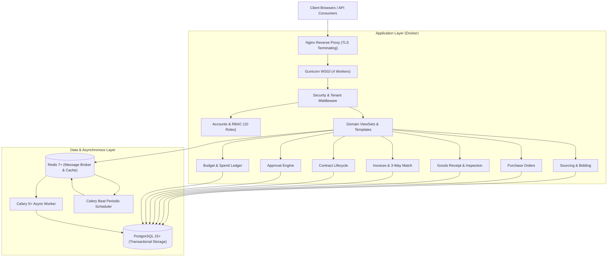
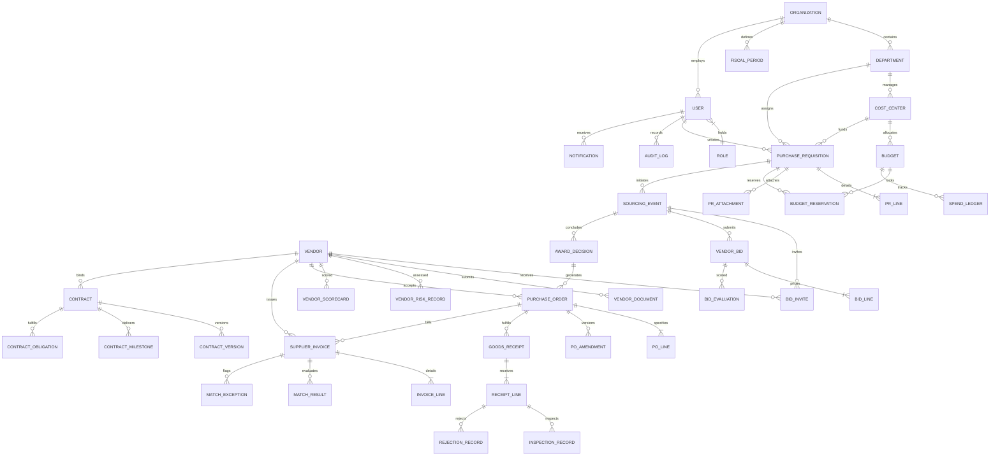

# Template 5 — Architecture, ERD & API Documentation

**Project Name:** ProcureSphere 360  
**Project Code:** HPE-PRD-2026-PROC01  
**Milestone:** Day 60 Integrated Beta Review (Review Build 2)  
**Partner:** VPD Technologies Pvt. Ltd.  
**Issuing Authority:** HPE Team  
**Evaluation Date:** 2026-11-24  

---

## 1. System Architecture Overview

ProcureSphere 360 is built as a multi-tenant, micro-modular monolithic ERP designed for high data integrity, strict auditability, and fast response times.



---

## 2. Relational Entity Relationship Diagram (ERD)

The database schema is fully normalized into 26 core entities across 12 domain applications:



---

## 3. Database Schema Migrations & Integrity

The schema uses native Django migrations designed for reproducible clean-slate provisioning:

- **Migration Count:** 68 total migration files across 12 domain applications.
- **Merge Migrations:** `0011_merge_accounts_migrations` and `0012_merge_20261027_1504` ensure conflict-free schema convergence.
- **Referential Protection:** All transactional references (e.g. `POLine` to `ReceiptLine`, `Budget` to `SpendLedger`) enforce `on_delete=models.PROTECT` to prevent accidental cascading data loss.
- **Precision:** All monetary amounts, balances, and line pricing utilize `DecimalField(max_digits=14, decimal_places=2)` — zero floating-point arithmetic is permitted in domain logic.

---

## 4. API Documentation & OpenAPI Specification

All APIs are versioned under `/api/v1/` and documented dynamically via `drf-spectacular`:

- **OpenAPI 3.0 Schema:** `/api/schema/`
- **Swagger UI:** `/api/docs/`
- **Total Registered API Endpoints:** 361 operations

### 4.1 Example Request / Response Payloads

#### A. Create Sourcing Event (`POST /api/v1/sourcing/events/`)
```http
POST /api/v1/sourcing/events/ HTTP/1.1
Content-Type: application/json
X-CSRFToken: <csrf-token>

{
  "title": "Enterprise Server Infrastructure RFQ",
  "event_type": "RFQ",
  "description": "Procurement of blade servers and rack switches",
  "bid_start_date": "2026-11-25T09:00:00Z",
  "bid_end_date": "2026-12-05T18:00:00Z",
  "currency": "USD"
}
```
**Response (`HTTP 201 Created`):**
```json
{
  "id": "645a916c-89c0-4345-bd3b-679ae9190cd4",
  "event_number": "RFQ-2026-00003",
  "title": "Enterprise Server Infrastructure RFQ",
  "event_type": "RFQ",
  "status": "DRAFT",
  "currency": "USD",
  "invited_vendors_count": 0,
  "created_at": "2026-11-23T11:20:00Z"
}
```

#### B. Department Approver Queue (`GET /api/v1/approver/queue/`)
```http
GET /api/v1/approver/queue/ HTTP/1.1
Authorization: SessionCookie
```
**Response (`HTTP 200 OK` — DEF-002 Verified):**
```json
[
  {
    "id": "c51d1e3f-757f-471e-be82-c9fa07f3bbf1",
    "pr_number": "PR-2026-00001",
    "title": "Enterprise Core Routers Upgrade",
    "requester_email": "requester@hpe.com",
    "department_name": "IT Infrastructure Operations",
    "cost_center_code": "CC-IT-101",
    "total_amount": "62000.00",
    "currency": "USD",
    "status": "MANAGER_REVIEW",
    "created_at": "2026-11-18T16:31:20Z",
    "urgency": "HIGH"
  }
]
```

#### C. Standardized Error Response (`HTTP 500` Sanitized — DEF-003 Verified)
```json
{
  "error": {
    "code": "INTERNAL_SERVER_ERROR",
    "message": "An unexpected internal server error occurred.",
    "details": "An unexpected error occurred. Please contact the system administrator.",
    "request_id": "8f347b45-9dd5-42c1-92fc-d36ee611480c"
  }
}
```
