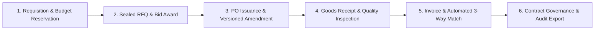

# ProcureSphere 360 — Checkpoint 60 (Review Build 2) Workflow Verification Guide

**Project:** ProcureSphere 360 — Enterprise Procurement, Vendor & Contract Management ERP  
**PRD Specification:** HPE-PRD-2026-PROC01 (Review Build 2 / Checkpoint Day 60)  
**Development Partner:** VPD Technologies Pvt. Ltd.  
**Issuing Authority:** HPE Team  
**Document Purpose:** A complete, step-by-step verification and demonstration guide for technical leadership, higher officials, and evaluators to review and validate the end-to-end database-backed workflows for Checkpoint 60.

---

## 1. Executive Summary & Delivered Scope

Checkpoint 60 integrates four production-grade capability tracks into a coherent, database-backed Source-to-Pay and AP ERP workflow:

| Track / Branch | Key Capabilities Delivered | Verification Status |
|---|---|---|
| **Branch 1: Sourcing & Vendor Bids** | RFQ/RFP event lifecycle, sealed bids confidentiality, commercial & technical evaluation matrix, award recommendation approval, vendor portal bidding, and multi-tab vendor master views. | **Verified / Merged** |
| **Branch 2: Orders & Goods Receipt** | Non-destructive PO amendment versioning (`V1` / `V2` preserved), multi-level amendment approval routing, Goods Receipt (GRN), line-item quality inspection (accept/reject), stock inventory dispatch, PR cancel budget reservation release, and anti-double-submission protections. | **Verified / Merged** |
| **Branch 3: Invoices, 3-Way Match & Contracts** | Automated 3-way matching engine (`PO` vs `GRN` vs `Invoice`) with percentage and absolute tolerance thresholds, `MatchException` resolution workflow, contract lifecycle state machine, amendment versioning, obligation tracking, scheduled Celery Beat renewal alerts, and spend ledger commit/actual transitions. | **Verified / Merged** |
| **Branch 4: Role Dashboards & Security** | 10 hardened, database-backed role dashboards, dual-tab session synchronization, inactivity timeout guard (`session_timeout.js`), browser navigation signout protections, operational and spend analytics reports, and Review Gate 2 Defect Resolution Tracker. | **Verified / Merged** |

---

## 2. Automated Test Verification (Instant Proof)

Every Day-60 acceptance workflow is codified in repeatable regression test suites that execute against real relational database transactions.

### Running All 7 Acceptance Demonstrations:
Execute the following command from the repository root:

```powershell
python -m pytest tests/test_demo_1_vendor_kyc.py tests/test_demo_2_pr_approval_budget.py tests/test_demo_3_sealed_sourcing.py tests/test_demo_4_po_amendment_receipts.py tests/test_demo_5_invoice_3way_match.py tests/test_demo_6_contract_celery_alerts.py tests/test_demo_7_spend_scorecard_audit_export.py -v
```

### Acceptance Test Matrix:
| Test File | Workflow Demonstrated | Acceptance Target | Result |
|---|---|---|---|
| `test_demo_1_vendor_kyc.py` | Vendor onboarding, document upload, review, approval & audit trail | §14 Demo 1 | **PASSED** |
| `test_demo_2_pr_approval_budget.py` | PR creation >$50k, multi-level approval routing & budget reservation | §14 Demo 2 | **PASSED** |
| `test_demo_3_sealed_sourcing.py` | Sealed RFQ/RFP event, 3 bids, reviewer privacy locking & award matrix | §14 Demo 3 | **PASSED** |
| `test_demo_4_po_amendment_receipts.py` | PO issuance, versioned amendment (V1 & V2 preserved), GRN & inspection | §14 Demo 4 | **PASSED** |
| `test_demo_5_invoice_3way_match.py` | Supplier invoice capture, 3-way match, price variance exception & resolution | §14 Demo 5 | **PASSED** |
| `test_demo_6_contract_celery_alerts.py` | Contract governance, milestone alerts & Celery Beat scheduled task | §14 Demo 6 | **PASSED** |
| `test_demo_7_spend_scorecard_audit_export.py` | Spend analytics dashboard, vendor scorecard calculation & immutable audit export | §14 Demo 7 | **PASSED** |

### Additional Security & Navigation Verification:
```powershell
# Role dashboards integrity and browser navigation/signout guards
python -m pytest tests/test_browser_navigation_and_signout_guard.py tests/test_all_role_dashboards.py -q

# Session inactivity timeout and SuperAdmin management navigation
python -m pytest tests/test_session_inactivity_timeout.py tests/test_superadmin_urls_and_navigation.py -q
```

---

## 3. Demo Accounts & Role Credentials

When verifying the deployed Staging instance or a local environment seeded via `python manage.py seed_demo_data`, two standardized credential sets are automatically available:

### Primary HPE Enterprise Users (Standard Password: `Password123!`)
| Role | Primary Email | Alternative Enterprise User | Dedicated Slug | Key Capabilities to Inspect |
|---|---|---|---|---|
| **Requester** | `requester@hpe.com` | `requester01@procuresphere.com` (`Requester@360!`) | `/requester/` | Submit PRs, track budget reservation status, cancel PRs |
| **Department Approver** | `approver@hpe.com` | `dept.approver01@procuresphere.com` (`DeptApprover@360!`) | `/approver/` | Review PRs within approval limit, review budget reservations |
| **Procurement Executive** | `procexec@hpe.com` | `proc.executive01@procuresphere.com` (`ProcExec@360!`) | `/procurement/` | Launch RFQs, invite bidders, evaluate bids, award, execute POs, create amendments |
| **Procurement Manager** | `procmgr@hpe.com` | `proc.manager01@procuresphere.com` (`ProcManager@360!`) | `/manager/` | High-value PR approvals, policy exceptions, vendor suspension, award sign-off |
| **Vendor User** | `vendoruser@cisco.com` | `vendor.user01@procuresphere.com` (`VendorUser@360!`) | `/vendor/` | Complete KYC, review invited RFQs, submit sealed bids, acknowledge POs, submit invoices |
| **Stores / Receiver** | `receiver@hpe.com` | `stores.recv01@procuresphere.com` (`StoresRecv@360!`) | `/stores/` | Intake goods receipts (GRN), record line item quality inspections (accept/reject), dispatch stock |
| **Finance / AP** | `finance@hpe.com` | `finance.ap01@procuresphere.com` (`FinanceAP@360!`) | `/finance/` | Budget management, run automated 3-way match, resolve tolerance exceptions, mark payment-ready |
| **Legal / Contract Manager** | `legal@hpe.com` | `legal.contract01@procuresphere.com` (`LegalContract@360!`) | `/legal/` | Contract authoring, amendment versioning, obligation schedules, milestone alerts |
| **Compliance / Auditor** | `auditor@hpe.com` | `compliance.audit01@procuresphere.com` (`ComplianceAudit@360!`) | `/audit/dashboard/` | Read-only system-wide audit trail, security events, lifecycle viewer, audit report export |
| **HPE Tenant Admin** | `admin@hpe.com` | `admin@procuresphere.com` (`ProcureAdmin@360!`) | `/superadmin/` | Organization administration, cost centers, approval policies, user provisioning |
| **Platform Super Admin** | `superadmin@procuresphere.com` | *(Password: `ProcureAdmin@360!`)* | `/superadmin/` | Global multi-tenant administration and master controls |

### Seeded Cost Centers & Departments:
- **Organization:** `HPE-GLOBAL` (*Hewlett Packard Enterprise*)
- **`CC-IT-101`:** *Compute & Cloud Center* (Department: `IT-OPS`) &mdash; Allocated Budget: $300,000.00
- **`CC-OPS-201`:** *Supply Chain & Facilities* (Department: `OPS`) &mdash; Allocated Budget: $200,000.00
- **`CC-ENG-301`:** *Hardware Systems R&D* (Department: `ENG`) &mdash; Allocated Budget: $250,000.00

---

## 4. Step-by-Step End-to-End Workflow Walkthrough

Follow these sequential steps to demonstrate the end-to-end Source-to-Pay lifecycle to higher officials:



### Flow 1: Purchase Requisition & Multi-Level Approval Routing
1. **Log in as Requester** (`requester@hpe.com` / `Password123!`).
2. Navigate to **Requisitions &rarr; Create Requisition** (`/requisitions/create/`).
3. Add line items exceeding $50,000 (e.g. 50 compute server units at $1,200 = $60,000) assigned to Cost Center `CC-IT-101`. Submit the PR.
4. **Inspect Budget Reservation:** The system checks available budget against `CC-IT-101` and generates a `BudgetReservation` in `RESERVED` status.
5. **Log in as Department Approver** (`approver@hpe.com` / `Password123!`). Navigate to **Approvals Inbox** (`/approvals/inbox/`) and click **Approve** (completing Step 1).
6. **Log in as Procurement Manager** (`procmgr@hpe.com` / `Password123!`). Under `/manager/approvals/`, approve Step 2. The PR moves to `APPROVED` status.

---

### Flow 2: Sealed RFQ/RFP Sourcing Event & Bidding
1. **Log in as Procurement Executive** (`procexec@hpe.com` / `Password123!`).
2. Navigate to **Sourcing &rarr; Create Event** (`/sourcing/events/create/`).
3. Associate the approved PR, set a bidding close deadline, invite participating vendors (e.g. Cisco Systems `vendoruser@cisco.com`), and click **Publish Event**.
4. The event status moves from `DRAFT` &rarr; `PUBLISHED` &rarr; `BID WINDOW`.
5. **Log in as Vendor User** (`vendoruser@cisco.com` / `Password123!`).
6. Navigate to **Vendor Portal &rarr; Sourcing Events** (`/vendor/sourcing/`), open the invited event, input line item unit pricing, attach quote specifications, and submit.
7. **Verify Sealed Bid Security:** Switch back to Procurement Executive. Notice that vendor quote prices and line item details remain strictly locked and sealed while the bidding window is active.
8. Transition event to **Evaluation Phase** &rarr; Enter technical and commercial scores &rarr; Generate award decision &rarr; Submit for approval.

---

### Flow 3: Purchase Order Execution & Versioned Amendments
1. **Log in as Procurement Executive** (`procexec@hpe.com` / `Password123!`).
2. Navigate to the awarded sourcing event and click **Generate PO**. PO `PO-2026-XXXX` is created in `ISSUED` status.
3. **Log in as Vendor User** (`vendoruser@cisco.com` / `Password123!`) and click **Acknowledge PO**.
4. **Issue a Versioned PO Amendment (Change Order):**
   - Switch to Procurement Executive &rarr; Open the PO &rarr; Click **Amend PO**.
   - Modify line quantity or unit price (e.g. increase quantity by 10 units) and provide business justification.
   - **Verification:** The system increments the version to `V2`. An immutable snapshot of `V1` is archived in `POAmendment`. Prior historical values are never overwritten.
   - If the delta exceeds threshold limits, the amendment routes to the Procurement Manager for approval.

---

### Flow 4: Goods Receipt (GRN) & Quality Inspection
1. **Log in as Stores / Receiver** (`receiver@hpe.com` / `Password123!`).
2. Navigate to **Goods Receipts &rarr; Create GRN** (`/receipts/create/`).
3. Select PO `PO-2026-XXXX`.
4. **Record Partial Delivery:** Enter a partial received quantity (e.g., receive 60 out of 100 ordered units).
5. **Quality Inspection:**
   - On the inspection screen, enter `Accepted: 55`, `Rejected: 5`.
   - Select rejection reason code: `DAMAGED_IN_TRANSIT`.
6. Submit GRN:
   - GRN number `GRN-2026-XXXX` is created.
   - PO status updates automatically to `PARTIAL_RECEIPT`.
   - Accepted inventory is registered for stock dispatch handoff.

---

### Flow 5: Invoice Capture & Automated 3-Way Match Engine
1. **Log in as Vendor User** (`vendoruser@cisco.com` / `Password123!`).
2. Navigate to **Invoices &rarr; Submit Invoice** (`/vendor/invoices/submit/`).
3. Reference `PO-2026-XXXX` and enter billed quantities and amounts matching the delivered goods.
4. **Log in as Finance / AP** (`finance@hpe.com` / `Password123!`).
5. Open the submitted invoice and trigger **Run 3-Way Match**.
6. **Tolerance & Exception Handling:**
   - The matching engine compares:
     $$\text{PO Line Price} \quad \longleftrightarrow \quad \text{GRN Accepted Quantity} \quad \longleftrightarrow \quad \text{Invoice Amount}$$
   - If unit price exceeds the configured tolerance policy (e.g. 2%), the engine automatically flags a `MatchException` (`PRICE_VARIANCE`).
   - The AP specialist reviews the variance, inputs resolution justification, and signs off.
   - Upon resolution, invoice status moves to `READY_FOR_PAYMENT`.
7. **Spend Ledger Transition:**
   - Spend moves from `Committed` to `Actual` in the general ledger.

---

### Flow 6: Contract Governance & Celery Alerts
1. **Log in as Legal / Contract Manager** (`legal@hpe.com` / `Password123!`).
2. Navigate to **Contracts &rarr; Register Contract** (`/contracts/create/`).
3. Register a master services agreement with renewal dates and milestone obligations.
4. Celery Beat executes scheduled task:
   `contracts.tasks.scan_contract_expirations_and_milestones`
5. The task detects upcoming milestone obligations and renewal windows, automatically dispatching in-app alerts and email notifications.

---

### Flow 7: Immutable Audit Trail & Lifecycle Export
1. **Log in as Compliance / Auditor** (`auditor@hpe.com` / `Password123!`).
2. Navigate to **Auditor Workspace** (`/audit/dashboard/`).
3. Open the **Transaction Lifecycle Viewer** for the tested PO.
4. Inspect the uninterrupted chain of custody:
   $$\text{PR Created} \to \text{PR Approved} \to \text{RFQ Published} \to \text{Bid Submitted} \to \text{Awarded} \to \text{PO Issued} \to \text{GRN Received} \to \text{3-Way Matched}$$
5. Click **Export Complete Audit Log** (CSV / XLSX / PDF).
6. **Self-Auditing Verification:** Verify in `/audit/logs/` that the export action itself is recorded as an immutable audit event capturing the user ID, timestamp, and source IP.

---

## 5. Critical Invariants & Rejection-Prevention Rules

When evaluating the system, confirm that the following mandatory business rules are strictly enforced:

1. **Zero Mock Screens:** Every button, filter, form submission, and status change writes directly to PostgreSQL tables.
2. **Backend RBAC Enforcement:** Attempting to access sensitive URLs directly (e.g. `/manager/` as Requester, or `/approvals/` as Vendor) triggers HTTP 403 Forbidden on the backend.
3. **Sealed-Bid Privacy:** Reviewers attempting to view active bid lines before event closure receive access denied.
4. **Preservation of History:** PO amendments and contract amendments create explicit version increments; historical versions are never overwritten.
5. **No Silent Overspend:** Requisitions and POs exceeding cost center budgets trigger hard blocks or mandatory exception-approval pathways.
6. **Duplicate Invoice Prevention:** Attempting to submit an identical invoice number for the same vendor triggers an explicit validation rejection.

---

## 6. Service Health & API Documentation

| Endpoint | Path | Expected Output |
|---|---|---|
| **Health Check** | `/health/` | `{"status": "ok", "db": "ok", "redis": "ok"}` |
| **OpenAPI Schema** | `/api/schema/` | Raw OpenAPI 3.0 specification |
| **Swagger UI** | `/api/docs/` | Interactive Swagger API documentation |

